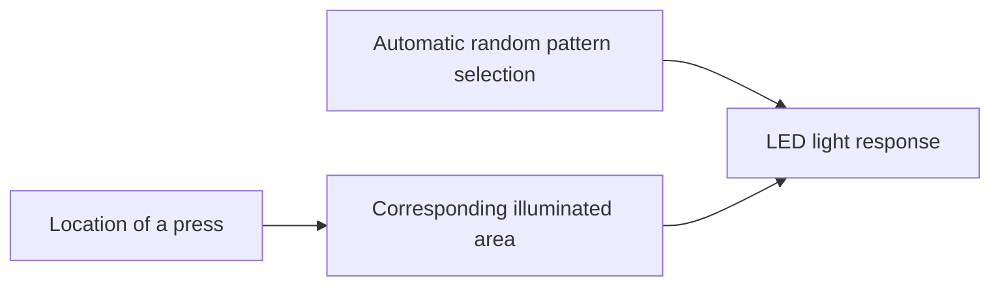

# Bianca portfolio content plan

2026-09-13 · 구성 및 영문 본문 초안

## 페이지가 전달할 한 가지 이야기

**익숙한 냉장고 사용 동작을 빛과 연결하고, 그 감각적 경험을 실물 크기의 작동하는 하드웨어로 구현했다.**

Bianca는 **다가오는 손을 은은한 빛으로 맞이하는 경험**과 **손잡이 사용에 연결되는 변화하는 빛**을 탐색했다. 거리센서의 감지 문제와 부품 고장으로 접근에 반응하는 ambient 효과를 제외하고, 최종적으로 압력 입력을 중심으로 구현했다. 최종적으로 누르는 위치에 따라 빛나는 위치가 달라졌고, 패턴은 사용할 때마다 자동으로 무작위 선택됐다. 사용자의 기억상 압력 세기에 따른 밝기 변화는 구현하지 않았다. 압력 입력 장치의 구체적인 종류와 배치는 확인되지 않았으므로 단정하지 않는다.

페이지에서 보여줄 역량은 경험의 구상, 행동과 반응의 설계, 센싱과 제어, 물리적 제작을 연결하는 능력이다. 공감각적 경험이나 기억에 남는 경험은 설계 의도로 서술하고, 성과는 실제 구현된 반응과 실물 제작으로 제시한다.

이 문서는 과거 자료와 현재 페이지를 대조한 구성안이다. 아래의 영문 본문과 캡션은 페이지에 사용할 초안이며, 자료 배치 및 근거 메모는 편집용이다.

## 전체 구성

| 순서 | 제목 | 독자가 이해할 내용 | 주 자료 |
| --- | --- | --- | --- |
| Hero | A familiar gesture, made visible. | 무엇을 만들었고 어디까지 구현했는가 | 기존 대표 이미지 |
| 01 / Motivation | Rediscovering a familiar gesture | 왜 이미 존재하는 제품과 냉장고를 여는 동작을 선택했는가 | 주방 장면, 당시 아이디에이션 스케치 일부 |
| 02 / Desk research | Aesthetics in the act of use | 당시 참고한 사용 경험의 미학이 Bianca의 설계에 어떻게 연결됐는가 | Ross & Wensveen (2010)에 연결한 한 문단과 출처 |
| 03 / Implementation | Shaping the experience through prototyping | 접근 반응을 시도한 이유, 실험에서 만난 문제, 최종 압력 입력으로 범위를 조정한 과정 | 초기 센서 실험, 의도와 최종 구현의 비교, 제작 사진 |
| 04 / Design outcome | A familiar action, a changing response | 구현 과정을 거쳐 완성한 반응은 무엇인가 | 약 60초의 전체 시연 영상 |
| 05 / Reflection | What building Bianca taught me | 실물 구현으로 배운 점과 다음에 탐색할 질문은 무엇인가 | 두 개의 구체적인 배움, 짧은 범위 설명 |

권장 순서는 Motivation → Desk research → Implementation → Design outcome → Reflection이다. Implementation은 의도한 경험, 초기 실험, 문제가 드러난 지점, 최종 선택의 순서로 구성한다. 독자가 범위를 조정한 이유를 이해한 뒤 Design outcome에서 전체 시연을 본다. Hero의 대표 이미지와 소개는 초반부터 결과의 모습을 보여주는 역할을 한다.

## Hero

**역할:** 첫 화면에서 감각적 의도와 실제 제작 범위를 함께 전달한다.

**분야 및 상태:** Physical computing · 2020 / Full-scale interactive prototype

**Headline**

A familiar gesture, made visible.

**Summary**

Bianca connects the familiar act of opening a refrigerator with light. A full-scale interactive prototype lights up an area corresponding to where the handle is pressed and randomly selects a light pattern with each use. The project explores how a brief physical encounter might become a richer sensory experience.

**기여도 표기:** 현재 페이지에 있는 역할 분담을 유지한다. Woojun Jung: Arduino code, electronics, physical construction. Yein Lim: material sourcing and procurement. Shared: motivation, desk research, and film. 새로운 세부 역할을 자료만 보고 추가하지 않는다.

**자료 배치:** 대표 이미지 옆에 소개와 기여도를 놓는다. 전체 시연 영상은 Implementation 다음인 04 / Design outcome에 배치한다.

## 01 / Motivation

**제목:** Rediscovering a familiar gesture

**핵심:** 당시 PDF의 선택 이유를 살린다. 집에 새로운 사물을 추가하기보다 기존 제품의 익숙한 행동에 인터랙션을 더하려 했고, 그중 무심코 사용하는 냉장고에 집중했다. 개인적인 디자인 관심으로 제시한다.

**Body**

We began by looking at familiar actions around the home. Adding an interaction to an existing object offered a way to work with habits already in place, and the refrigerator became our focus. Opening its door involves reaching, making contact, and pulling—small physical sensations that can easily pass unnoticed. Could light make this brief encounter worth noticing?

**자료 배치:** 현재 주방 일러스트를 주 시각물로 사용한다. 이 그림의 역할은 일상의 상황과 접촉 지점을 보여주는 것이다. 당시 PDF 3쪽의 냉장고 스케치는 선택 과정을 보강할 필요가 있을 때 작은 보조 이미지로 배치한다. 전체 브레인스토밍 판을 크게 넣을 필요는 없다.

**Caption**

A routine encounter: reaching for the handle and opening the door.

**시각물 수정 방향:** 사람을 관통하는 배경 선을 정리하고, 손과 손잡이의 접촉을 구체화한다. 배경의 상단 여백과 주변 가구 비중을 줄인다. 최종 빛의 반응은 04 / Design outcome의 실제 시연 영상에서 보여준다.

**근거:** 당시 PDF 2–4쪽. 원문의 ‘기대감을 불러일으킨다’는 표현은 의도로 바꿔 서술한다.

## 02 / Desk research

**제목:** Aesthetics in the act of use

**역할:** 당시 실제로 참고한 Ross & Wensveen (2010)의 관점과 Bianca의 설계 의도를 한 문단으로 연결한다. 2026-09-13 사용자가 당시 참고 사실을 확인했다. 이 문헌 하나만 출처로 명시한다.

**Body**

Ross and Wensveen describe aesthetics as something that unfolds through bodily action and product behavior. This perspective informed Bianca’s focus on the act of using a refrigerator: the reach, the contact, and the movement of opening. The design intent was to extend the sensory character of that familiar encounter through light.

Reference: Philip R. Ross and Stephan A. G. Wensveen (2010), “Designing Behavior in Interaction: Using Aesthetic Experience as a Mechanism for Design,” International Journal of Design, 4(2), 3–13. [Original article](https://www.ijdesign.org/index.php/IJDesign/article/view/765/297).

**편집 메모:** 제목, 한 문단, 작은 출처 표기로 구성한다. 문헌의 관점과 Bianca의 설계 의도를 이어서 설명하며, 논문이 Bianca의 사용자 효과를 검증했다는 의미로 확장하지 않는다. 다음 Implementation에서 이 의도를 구현하며 선택한 입력과 반응을 설명하고, Design outcome에서 최종 시연을 보여준다.

## 03 / Implementation

**제목:** Shaping the experience through prototyping

**역할:** 경험을 구현하는 과정에서 무엇을 시도했고, 왜 범위를 조정했는지 보여준다. 각 소주제를 ‘의도 → 실험 또는 제작 자료 → 선택’으로 연결한다.

**Intro**

I developed the Arduino code, integrated the electronics, and constructed the full-scale prototype. The intended experience began before contact: a subtle glow would gradually appear as the user reached toward the refrigerator. Prototyping led me to revise that interaction and focus the final build on pressure input during handle use.

### A. Exploring a response before contact

**Body**

I explored using a distance sensor to let the refrigerator respond before the hand made contact. As the user approached, the door would gradually glow at a low intensity, creating an ambient response within the act of reaching. The early sensor experiment tested this direction.

**자료 배치:** sensor_practice.mp4를 이 소주제에 배치한다. 실제 파일명은 sensor_practice.mp4이며, 사용자가 설명한 접근 반응의 초기 실험 자료다. 이 영상은 완성된 냉장고의 ambient 반응을 보여주는 것으로 표기하지 않는다.

**Caption**

Early distance-sensor experiment for an approach-responsive glow.

### B. Revising the interaction

**Body**

Unreliable detection, sensor malfunctions, and faulty units prevented me from carrying the approach response into the final build. I removed that part of the interaction and continued with pressure input. This narrowed the intended experience from a response that began during approach to one activated through contact with the handle.

**시각물:** ‘의도한 경험’과 ‘최종 구현’의 두 행을 같은 단계 위에 나란히 배치한다. 구현하지 않은 효과는 Planned / Omitted from final build로 명확하게 표시한다.

| 순간 | 의도한 경험 | 최종 구현 범위 |
| --- | --- | --- |
| Approach / Reach | 거리 감지에 따라 문이 서서히 낮은 강도로 빛남 | 접근 감지에 연결된 ambient 효과 제외 |
| Contact / Handle use | 접촉 위치와 빛의 연결 | 누르는 위치에 따라 빛나는 위치가 달라지는 반응 유지 |
| Repeated use | 반복되는 행동에 변화 부여 | 매 사용 시 패턴 자동 무작위 선택 |

**편집 메모:** 원인 설명은 이 프로젝트에서 경험한 센서와 감지 문제로 한정한다. 제품군 전체의 불량률이 높다는 일반화나, 최종 방식의 정확도·신뢰성이 측정으로 향상됐다는 주장은 추가하지 않는다.

### C. Integrating input, light, and the physical form

**Body**

The revised prototype connected the location of a press to a corresponding illuminated area. I adapted LED library examples and integrated the electronics into the full-scale body and doors. The final system randomly selected a light pattern with each use.

**현재 확인된 수준의 입력과 반응 도식:** 누르는 위치와 빛나는 영역의 관계를 표시한다. 센서 개수나 내부 배선 구조를 나타내는 상세 회로도가 아니다.

**자료 배치:** 제작 사진에서 전자부품 작업, 문 내부 LED 설치, 외형 제작을 순서대로 보여준다. 코드와 외형의 상세한 결합 방식은 사진 및 최종 입력 장치 확인에 맞춰 설명한다.

**Caption**

Bringing the input, lighting, and full-scale structure into one working prototype.

**기술 정보의 범위:** 사용자 확인에 따라 최종 반응은 누르는 위치에 따른 발광 위치 변화로 설명한다. 압력 세기에 따른 밝기 변화는 구현 내용으로 포함하지 않는다. 구체적인 압력 입력 장치의 모델, 개수, 배치는 확인되지 않았으므로 현재 도식에는 표시하지 않는다.

**보조 제작 이야기:** PDF 8쪽에는 문과 프레임 사이의 스위치와 interrupt 활용을 시도하다가 접히는 손잡이 안쪽의 누름 스위치로 변경한 기록이 있다. 최신 설명의 압력 입력 장치와의 관계가 확인되면 이 사례를 코드와 물리 구조의 결합을 보여주는 짧은 문단으로 추가한다. 현재 단계에서는 최종 하드웨어의 상세 구조로 단정하지 않는다.

## 04 / Design outcome

**제목:** A familiar action, a changing response

**역할:** 앞서 설명한 제작 판단을 거쳐 실제로 완성한 반응을 전체 시연 영상으로 보여준다.

**Intro**

The full-scale prototype lights up an area corresponding to where the handle is pressed. Each use randomly selects a light pattern, bringing variation into a familiar gesture. The demonstration below shows the implemented interaction.

**자료 배치:** 소개문 아래에 bianca_demo.mp4 전체를 배치한다. 원본 길이는 약 59.96초이며, 타이틀을 포함한 전체 시연을 유지한다. 이 구간에서는 완성된 경험에 집중하고 앞선 시행착오를 다시 길게 설명하지 않는다.

**재생 방식:** 사용자가 직접 재생할 수 있게 재생·일시정지·탐색·음량·전체화면 조작을 제공한다. 재생 전에는 손과 빛의 반응이 보이는 정지 장면을 포스터로 사용한다. 약 16초 장면을 후보로 삼고, 실제 포스터 제작 시 선명도와 구도를 확인한다. 포스터 선택은 영상의 시작 지점을 바꾸지 않는다.

**Caption**

Full demonstration of the full-scale interactive prototype · 1 min.

**근거와 범위:** 사용자 확인에 따라 최종 결과는 누르는 위치에 대응하는 발광 위치와 패턴 자동 무작위 선택으로 설명한다. 접근에 따른 ambient 발광은 최종 구현에서 제외됐고, 압력 세기에 따른 조도 변화도 구현 결과로 소개하지 않는다. PDF의 거리센서 위치 매핑 코드를 최종 구조로 다시 제시하지 않는다.

## 05 / Reflection

**제목:** What building Bianca taught me

**Learning 1 — Choosing the scope of the experience**

The approach response would have extended the interaction into the moment before contact. Removing it changed the scope of the experience. The final prototype focused on the handle action, while the gradual ambient response remained a direction to revisit.

**Learning 2 — Experience and implementation develop together**

Building Bianca showed me how an intended experience depends on the sensing and physical structure that make it possible. Working through those constraints required decisions about which parts of the interaction to carry into the final prototype.

**Next question**

A future iteration could revisit a gradual response during approach and examine how it transitions into the response at contact. Repeated-use studies could also explore whether the changing light continues to invite attention over time.

**편집 메모:** 위 회고는 확인된 과정에 근거한 제안 문장이다. 실제로 느낀 배움에 맞춰 사용자가 조정할 수 있다. ‘사용자가 더 즐거워했다’, ‘기억에 남았다’, ‘동일한 성능을 유지했다’, ‘신뢰성이 향상됐다’는 결과를 추가하지 않는다.

## 자료 인벤토리와 사용 우선순위

| 자료 | 확인한 내용 | 사용 위치 | 우선순위 |
| --- | --- | --- | --- |
| bianca_demo.mp4, 약 59.96초 | 타이틀, 전신 사용 장면, 손 위치에 대응하는 빛, 다른 빛 패턴 | Design outcome | 최상 |
| sensor_practice.mp4, 약 12.01초 | 접근에 반응하는 ambient 효과를 위한 거리센서 실험(사용자 설명) | Implementation A | 최상 |
| bianca_building.png | 외형 가공, 전자부품 조립, 코딩, 완성 전 외형 | Implementation C | 최상 |
| bianca_motivation.png | 주방에서 손잡이로 손을 뻗는 장면 | Motivation | 높음 |
| 당시 PDF 3쪽 | 집 안 행동 아이디에이션, 냉장고 스케치 | Motivation 보조 | 선택 |
| 당시 PDF 4쪽 | 기존 사물과 냉장고 선택 이유, 위치 매핑과 빛 구상 | 본문 근거 | 높음 |
| 당시 PDF 5쪽 | 1:1 제작 기록, LED 설치 사진 | Implementation | 높음 |
| 당시 PDF 6–7쪽 | 거리센서 위치 매핑 코드, 두 빛 효과 설명 | 개발 당시 기록; 최신 사용자 설명과 구분 | 보조 |
| 당시 PDF 8쪽 | 스위치 위치 수정, 센서 고장과 단일 거리센서 사용 기록 | 최신 설명과 다른 제작 단계의 기록인지 확인 필요 | 보조 |
| 당시 PDF 9쪽 | 손 위치에 따른 빛 위치, 두 패턴의 결과 사진 | Design outcome 보조; 구체적인 센싱 방식은 사용자 설명을 따름 | 보조 |

Design outcome은 전체 영상을 사용한다. Implementation의 센서 실험과 포스터 후보는 실제 미디어 준비 단계에서 연속 재생과 선명도를 확인한다.

## 근거와 표현 관리

| 주제 | 출처 | 사용할 표현 |
| --- | --- | --- |
| 기존 제품의 일상 동작을 출발점으로 삼음 | PDF 2–4쪽 | We began by looking at familiar actions around the home. |
| 실물 크기 구현 | PDF 5쪽, 제작 사진, 데모 | Full-scale interactive prototype |
| 접근 시 낮은 강도의 ambient 빛을 의도 | 최신 사용자 설명, sensor_practice.mp4 | An intended gradual glow during approach |
| 감지 문제와 센서 고장 때문에 접근 효과 제외 | 최신 사용자 설명 | Omitted from the final build |
| 최종적으로 압력 입력만 사용 | 최신 사용자 설명 | Pressure input; exact device type unspecified |
| 누르는 위치에 따라 빛나는 위치가 달라짐 | 사용자 후속 확인 | The illuminated area corresponds to the location of a press. |
| 압력 세기와 밝기의 연동 | 사용자 기억상 구현하지 않음 | Do not present pressure-to-brightness mapping as implemented. |
| 단일 거리센서 사용 및 손잡이 안쪽 스위치 | PDF 8쪽 | Archival development record; do not label as final architecture |
| 위치를 한정한 rainbow와 무작위 점등 효과 | PDF 7·9쪽, 데모 | Two implemented light behaviors |
| 최종 패턴 자동 무작위 선택 | 2026-09-13 사용자 확인 | Randomly selects a light pattern with each use |
| 개인 역할 분담 | 현재 Bianca 페이지의 메타 정보 | 현재 기여도 표기 유지 |
| 몸의 행동과 제품 반응의 미학 | Ross & Wensveen (2010) 원문, 당시 참고했다는 2026-09-13 사용자 확인 | This perspective informed Bianca’s focus… |

최신 사용자 설명을 최종 구현의 기준으로 삼는다. ‘최종 거리센서 1개 사용’이라는 이전 구성안의 문장은 철회했다. 누르는 위치에 따른 발광 위치 변화는 사용자 확인을 반영한다. 압력 입력 장치의 종류와 배치 등 구체적인 센싱 방식은 단정하지 않고, 압력 세기에 따른 밝기 변화는 구현 내용에서 제외한다. 문 각도에 비례하는 색 변화나 연속적인 위치 추적도 현재 자료만으로 설명하지 않는다.

프로젝트 기간은 현재 페이지의 Feb.–May 2020 표기를 이 문서에서 변경하지 않았다. 과거 파일의 6월 날짜만으로 실제 제작 종료일을 새로 추정하지 않는다.

## 원본 자료 바로가기

- [당시 발표 및 제작 기록 PDF](</Users/jeong-ujun/Library/CloudStorage/Dropbox/유학 준비/personal_website/assets/projects/bianca/Bianca_2016220030정우준 2015220062임예인.pdf>)
- [완성 데모](</Users/jeong-ujun/Library/CloudStorage/Dropbox/유학 준비/personal_website/assets/projects/bianca/bianca_demo.mp4>)
- [센서 실험](</Users/jeong-ujun/Library/CloudStorage/Dropbox/유학 준비/personal_website/assets/projects/bianca/sensor_practice.mp4>)
- [제작 사진](</Users/jeong-ujun/Library/CloudStorage/Dropbox/유학 준비/personal_website/assets/projects/bianca/bianca_building.png>)
- [Motivation 일러스트](</Users/jeong-ujun/Library/CloudStorage/Dropbox/유학 준비/personal_website/assets/projects/bianca/bianca_motivation.png>)
